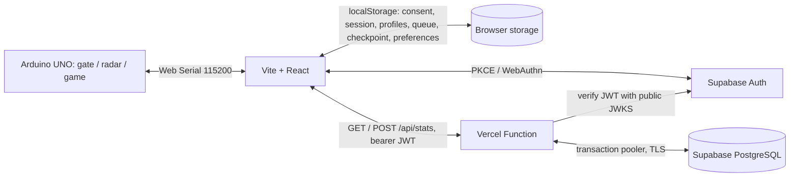

# Архітектура Arduino Gate Control

## Активний шлях

`src/main.tsx` mounts `app/page.tsx`. The Vite build emits `dist/`, and Vercel
serves `api/stats.ts` alongside it. The Next.js, Cloudflare worker and D1 files
remain optional legacy infrastructure. The page owns language, the control/game
tab, device connection and gate/radar telemetry. Only its `selectTab` path may
switch tabs while a game result or checkpoint needs protection.

`app/GamePanel.tsx` owns the game lifecycle. `app/game/waves.ts` plans seeded,
repeatable waves from `balance.ts`; `runtime.ts` updates the 900×540 world in
bounded steps; `rendering.ts` draws the same world in a letterboxed canvas at
every viewport. `input.ts` combines keyboard, touch and Arduino steering.
`controllerNavigation.ts` and `useControllerNavigation.ts` map the connected
joystick to focus, activation and back actions outside combat. The menu,
HUD, overlays and career panels present state; `audio.ts` and `useGameAudio.ts`
play browser tracks or send short buzzer commands. A safe checkpoint is written
only between waves and is scoped to the profile's immutable owner ID.

The UNO sketch in `public/arduino-smart-gate.ino` speaks newline-delimited
commands and JSON telemetry over USB at 115200 baud. Gate, radar and game modes
are mutually exclusive. Browser demo mode needs no serial port; Web Serial
requires a compatible browser and a secure context. The Arduino joystick's
switch remains the fire input during combat, with a hold for the equipped
power. In the game menu the board is placed in paused game mode so its faster
telemetry captures short switch presses reliably.

## Identity and statistics

The account choice is stored locally. The Supabase browser client is created
only after account consent. Sessions use localStorage without cookies; Google,
email/password and passkeys are gated by provider settings, platform support or
the server toggle. Apple stays disabled in the client until its external
Developer configuration is complete. `completeAuthRedirect()` is the single
PKCE callback handler; it exchanges a code once and removes redirect secrets
from the URL. `server/authVerify.ts` verifies bearer JWTs using Supabase's
public JWKS before any database mutation.

The profile vault is `arduino-gate-game-stats:v4` in localStorage. It retains
profiles and pending `run.completed` events across offline periods, sign-out
and retries. A completed run is saved locally before network activity. The
browser confirms the account profile, sends queued events in batches of at
most five, and then refreshes the leaderboard. `eventId = runId`; the server
hashes the validated event and stores it in the permanent sync ledger, so
retrying the same event is a duplicate and cannot increment totals twice.
The client removes an event from the queue only after a valid per-event
acknowledgement (including a `duplicate` retry). A former response decoder
dropped the `results` field after successful sync, leaving applied events
queued with `invalid_response`; preserving and checking those acknowledgements
lets the queue drain without recording the run twice.
The live audit also found three malformed batch INSERTs: the Postgres.js
dynamic insert helper already supplies the column list and VALUES, so it must
follow the table name directly. The corrected statements were verified against
live PostgreSQL; regression tests compile the actual tags with Postgres.js.
It never silently drops a rejected event. A profile bound to one auth user
cannot sync under another user's token.
The untouched v3/v2/v1 keys remain recovery copies. New events use a separate
v4 key because an old v3 tab sanitizes away unfamiliar provenance fields.
A read-only v3 bridge imports late offline events as legacy, with persistent
receipts that prevent an acknowledged dormant queue from returning after the
recent-ID window expires or a migrated profile is forgotten. Initial migration
keeps profile and checkpoint ownership; an incompatible owner is kept separate.

`shared/gameStats.ts` defines the request/response contract and validation for
both browser and API. `api/stats.ts` aggregates runs in short Postgres
transactions. Ordered SQL migrations live in `db/migrations/`; 0001–0006 are
the production baseline. Migration 0006 adds `game_runs.statistics_source`
and four separate aggregate tables for `demo`, `arduino` and `legacy`. New
runs capture the physical connection status at launch and retain it after a
disconnect or checkpoint restore. Historical runs and old queued events have
unknown provenance; they stay in `legacy` without altering old event hashes.
Keyboard/touch input by itself cannot prove whether an Arduino was connected.
The migration backfills old totals only into `legacy`; invoker triggers count
each new run and power row atomically, including inserts by the previous API
during rollout. Profile, career and leaderboard surfaces select one source at
a time. Original overall aggregates and unlocked achievements remain for
compatibility. The migration must be applied before deploying code that
queries its new tables or writes the source column. It was applied and
verified in production on 2026-10-03; existing data fingerprints stayed unchanged.

All game tables in the exposed `public` schema have RLS enabled and no browser
Data API policies or CRUD grants. The browser goes through `/api/stats`; the
function's database role reaches Postgres through a TLS transaction-pooler
connection stored only in Vercel. A plain `npm run dev` serves Vite but no
`/api/stats` function. For local end-to-end API testing use `npx vercel dev`
with `SUPABASE_DATABASE_URL` and a disposable Supabase project.

The server's stored totals and the browser's optimistic local totals can
temporarily differ while offline. The UI reports the sync state and keeps the
queue until a valid acknowledgement. A legacy access-code profile without an
account remains readable locally but is not uploaded or merged into a new
account because ownership cannot be proven.
